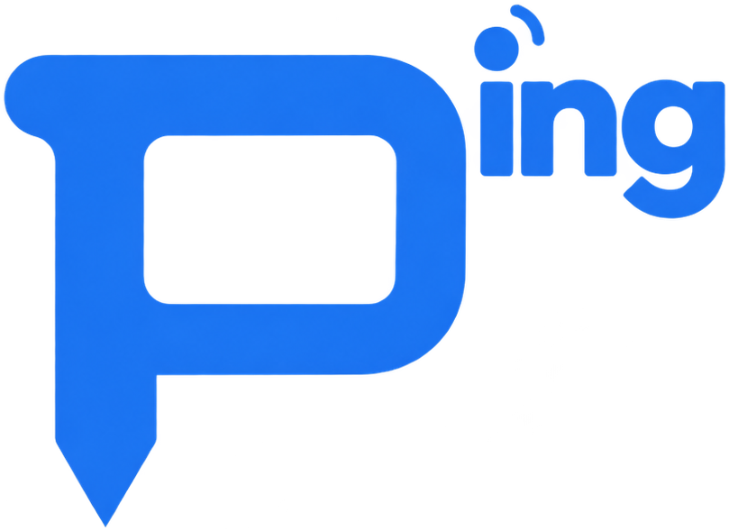
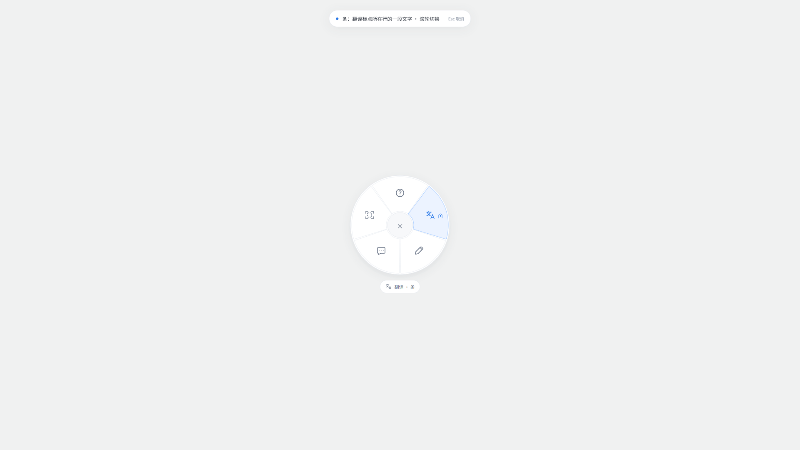
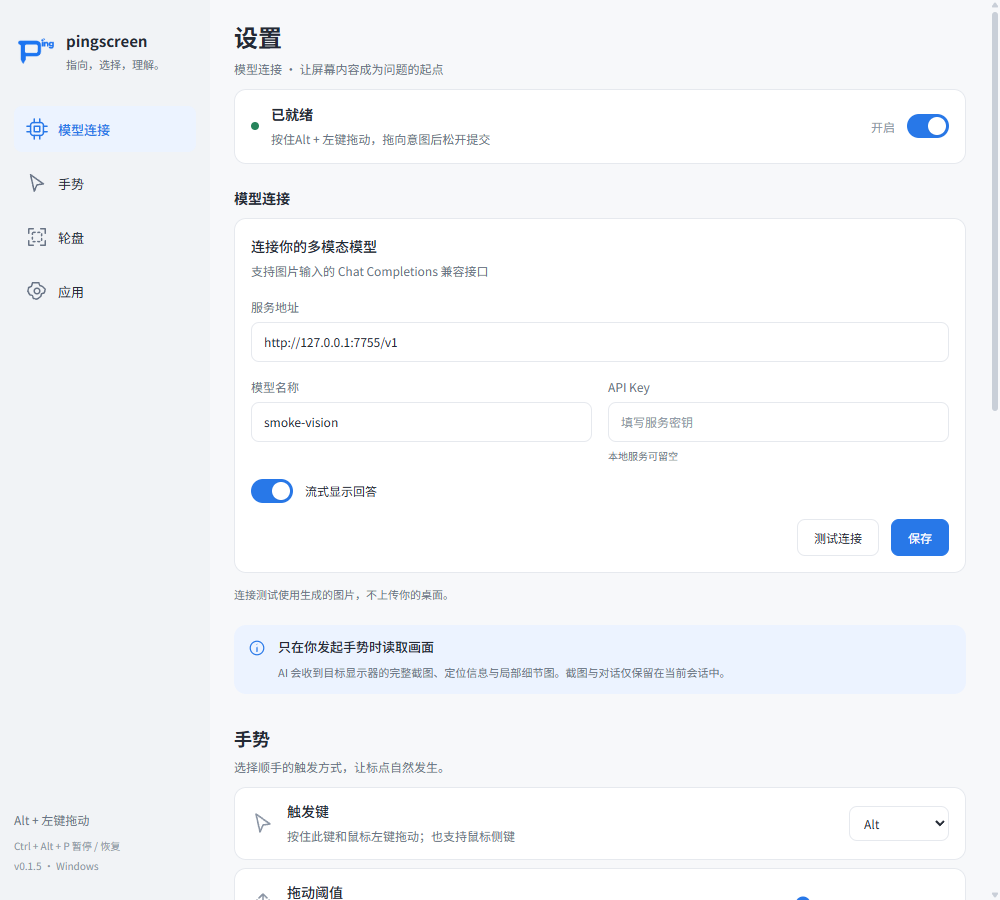

<div align="center">
  
  <h1>pingscreen</h1>
  <p><strong>把问题，放在屏幕上。</strong></p>
  <p>按住 <strong>Alt + 鼠标左键</strong>，拖向一个意图，松开即可。<br />在任何桌面内容上，解释、翻译、改写，或问一个具体问题。</p>
  <p>
    <a href="#安装">安装</a> ·
    <a href="#使用">使用</a> ·
    <a href="#设置">设置</a> ·
    <a href="#从源码构建">从源码构建</a>
  </p>
  <p>
    
    
    <a href="LICENSE"></a>
  </p>
  
</div>

## 安装

面向 **Windows x64**，目前主要在 Windows 11 上验证。

**当前正式版 0.1.5：** 已整合 0.1.4 Demo 的完整界面与设置交互，安装包位于 `release/pingscreen-Setup-0.1.5.exe`。

源码已采用新产品 Logo；已发布的 0.1.5 安装包保持原样，新 Logo 将在下次发布中提供。

1. 运行 `pingscreen-Setup-0.1.5.exe` 完成安装。
2. 打开应用，填写服务地址、模型名称和 API Key。模型需支持 **图片输入的 Chat Completions 兼容接口**；不要求鉴权的本地服务可留空密钥。
3. 点击 **「测试连接」** 检查填写内容，再点击 **「保存」** 保存模型配置。测试不会自动保存。应用常驻系统托盘。

服务地址填写基础地址（如 `https://your-provider.example/v1`）或完整的 `/chat/completions` 地址。连接测试使用生成的图片，不上传桌面。

更新时先从托盘退出旧版，再安装到原目录，模型设置会保留。

正式版沿用 `%APPDATA%\pingscreen`；Demo 的 `%APPDATA%\pingscreen-demo` 配置独立。仅用过 Demo 的用户请在正式版重新配置模型。

## 使用

| 想要做什么 | 操作 |
| --- | --- |
| 解释、翻译或改写 | 在目标上按住 **Alt + 左键** 拖动，选中对应扇区后松开 |
| 自定义提问 | 拖向「提问」后松开，输入问题并提交 |
| 框选一片区域 | 拖向「框选」后松开，在冻结画面上画出矩形，再选择意图 |
| 切换翻译范围 | 在翻译扇区滚动一格滚轮，切换「点」／「条」模式 |
| 取消 | 在中心松开、右键、Esc，或提前松开触发键 |
| 暂停／恢复 | **Ctrl + Alt + P** |
| 打开设置／退出 | 单击托盘图标打开设置；右键菜单可暂停、重启输入助手或退出 |

轮盘从上方开始顺时针依次为：**解释、翻译、改写、提问、框选**。Alt + 单击不提问。

**翻译「点」**聚焦指向的文字；**「条」**由模型结合上下文判断所在行的一段连续文字。每次新手势默认回到点模式。解释默认中文，翻译默认译为中文，改写保持原文语言。

回答支持 Markdown、复制和继续追问。**追问沿用同一张截图**，需要最新画面时请重新发起手势；点击「查看 AI 所见画面」可核对截图与目标位置。

## 设置

- **模型连接：** 自选服务地址、模型与密钥，可开启或关闭流式回答。
- **手势与轮盘：** 支持 Alt、Ctrl、Shift 或鼠标侧键 4／5；可调整拖动阈值，选择四项／五项轮盘。
- **开机启动：** 开启后常驻托盘，随时用快捷键暂停。

配置页连续显示模型连接、手势、轮盘与应用四个部分，支持平滑滚动、轻度吸附及左侧定位。顶部开关可直接暂停／恢复手势。轮盘内仅显示原创图标，所选意图及翻译模式显示在轮盘外侧。

手势、轮盘和开机启动修改后立即保存；模型配置使用独立的「测试连接」和「保存」按钮，测试使用当前草稿且不保存。页面最多滚动到版权声明底部，不增加尾部空白。

各部分按内容高度紧凑排列；应用介绍仅保留版本与平台，底部「基于 lolPing 开源项目」链接可打开原项目仓库。

<details>
<summary>查看设置界面</summary>

<p align="center"></p>

</details>

## 隐私与限制

**每次提问会向你配置的模型服务发送目标所在显示器的完整截图、定位信息和局部细节图；框选仍会发送整屏上下文。** 其他显示器不会发送，应用不持续录屏。截图与对话只保留在当前会话内存中，不保存历史文件。

API Key 使用 Windows 系统加密保存，设置位于 `%APPDATA%\pingscreen\settings.json`。模型服务的数据留存与费用遵循其自身政策。

支持多显示器坐标处理与 HDR 截图转换。管理员窗口、安全桌面、受保护内容及独占全屏不保证支持；全屏应用默认暂停手势。触发键拖动会替代其他应用的同键操作，可更换触发键或暂停。当前不提供跨应用自动操作。

## 从源码构建

<details>
<summary>展开环境要求与构建命令</summary>

需要 Windows x64、Node.js **22.12+**，以及 Visual Studio 2022 的 **「使用 C++ 的桌面开发」** 工具链。

```powershell
npm install
node node_modules/electron/install.js
npm run build:helper
npm run dev
```

也支持 Zig **0.14.1**：将可执行文件路径设为 `PINGSCREEN_ZIG`，或放到 `.tools/zig-x86_64-windows-0.14.1/zig.exe`。

| 命令 | 作用 |
| --- | --- |
| `npm run typecheck` | 类型检查 |
| `npm run build:brand` | 从已确认的产品 Logo 生成界面、应用、托盘与 Windows 图标 |
| `npm test` | 应用自动测试 |
| `npm run test:helper` | 原生输入与 HDR 颜色测试 |
| `npm run smoke` | 使用生成画面和模拟模型验证完整流程 |
| `npm run dist` | 生成 Windows x64 安装包，输出至 `release/` |
| `npm run verify:release` | 检查正式版归档、原生助手和安装包完整性，并生成 SHA-256 校验文件 |
| `npm run demo` | 单独构建隔离配置的 Demo ZIP |

当前正式版检查见 [0.1.5 验证记录](docs/verification/0.1.5.md)，此前性能记录见 [0.1.2 验证记录](docs/verification/0.1.2.md)。

</details>

## 开发文档

[文档目录](docs/README.md) · [版本变化](docs/changelog.md) · [Git 与发布流程](docs/versioning.md) · [屏幕聚焦计划](docs/plans/2026-10-14-screen-focus.md)

## 致谢与许可

采用 [MIT 许可证](LICENSE)。原生输入助手、多显示器坐标处理与进程恢复逻辑源自 [lolPing](https://github.com/darrenprx/lolPing)，版权声明见 [第三方许可](THIRD_PARTY_LICENSES.txt)。本项目使用原创界面与图标，不包含 Riot Games 的图像、动画或音效。
