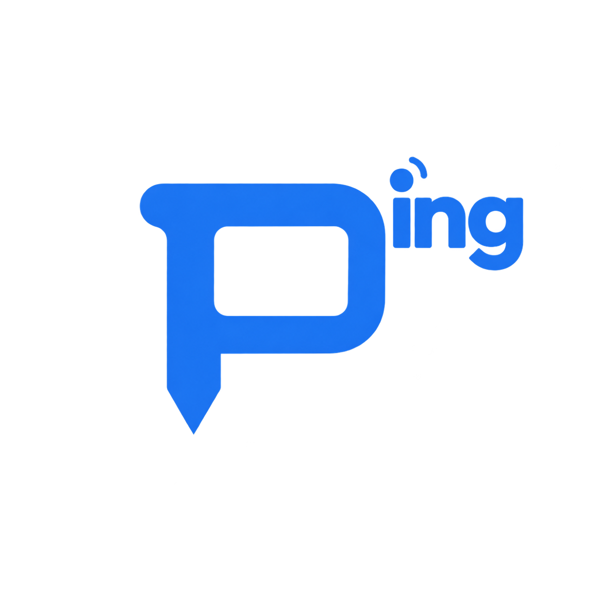
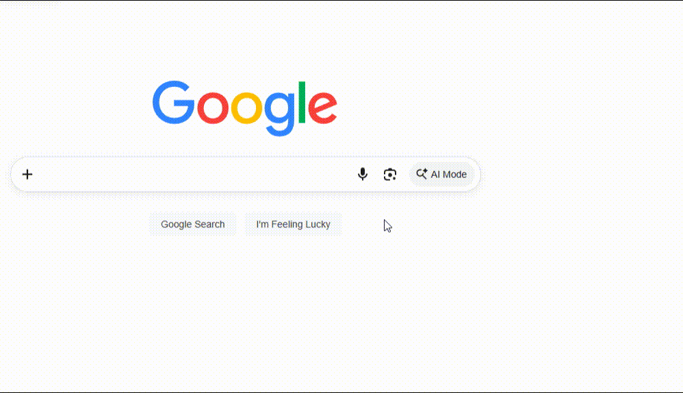

  
  
<strong>PingScreen 哪里不会点哪里</strong>

  
指向屏幕上的文字、按钮、图片或图表，让 AI 解释、翻译、改写，或回答你的问题。 按住 <strong>Alt + 鼠标左键</strong>，拖向一个意图，松开即可。

  

    <a href="#安装">安装</a> ·
    <a href="#使用">使用</a> ·
    <a href="#设置">设置</a> ·
    <a href="#隐私与数据">隐私与数据</a>
  

  

    
    
    
  

  

## 安装

当前支持 **Windows x64**，主要在 Windows 11 环境下验证。

1. 从 [最新正式版](https://github.com/syityx/PingScreen/releases/latest) 获取 `pingscreen-Setup-<版本号>.exe`，运行安装程序。
2. 打开 pingscreen，下拉选择云端服务商与图片模型，填写对应的 API Key；其他兼容服务选择「自定义」。
3. 点击 **「测试连接」**，确认连接成功后点击 **「保存」**，然后回到桌面开始使用。

内置通义千问（百炼）、硅基流动、豆包（火山方舟）、OpenAI、Gemini、DeepSeek，DeepSeek 的模型选项包含 **DeepSeek-Flash**。云端地址自动配置；模型下拉框选择「其他模型」可填写其他图片模型 ID，火山方舟填写自己已开通的图片模型或部署 ID（ep-…）。百炼和火山方舟预设面向中国大陆地域，其他地域或代理地址请选择自定义。

模型需支持 **图片输入的 Chat Completions 兼容接口**。自定义服务地址可填写基础地址（如 `https://your-provider.example/v1`）或完整的 `/chat/completions` 地址；Ollama 可填写 `http://localhost:11434/v1` 和本机已安装的图片模型名称，不要求鉴权时 API Key 留空。示例地址需替换为实际服务地址。预设模型与接口的官方依据见 [连接核对记录](docs/model-providers.md)。

**测试连接不会自动保存配置**，测试使用生成的图片，不上传桌面。关闭设置窗口后，应用仍常驻系统托盘；单击托盘图标可重新打开设置。

更新时先从托盘菜单退出旧版，再安装到原目录，已有设置会保留。

## 使用

将鼠标放在目标上，按住 **Alt + 左键** 向外拖动，选择意图后松开。

| 想要做什么 | 操作 |
| --- | --- |
| 解释内容 | 选择「解释」，理解文字含义、界面用途、图片或图表 |
| 翻译文字 | 选择「翻译」，默认译为中文 |
| 改写文字 | 选择「改写」，默认保持原文语言 |
| 自定义提问 | 选择「提问」，输入具体问题并提交 |
| 框选区域 | 选择「框选」，在冻结画面上拖出矩形，再点击意图 |
| 取消手势 | 在中心松开、点击右键、按 Esc，或提前松开触发键 |
| 暂停／恢复 | 按 **Ctrl + Alt + P**，或使用设置页顶部开关、托盘菜单 |

默认五项轮盘从正上方开始，顺时针依次为：**解释 → 翻译 → 改写 → 提问 → 框选**。默认四项不含框选；配置后按你的功能顺序显示。触发键加单击不会提问。

### 自定义轮盘

设置的「轮盘」分类只显示轮盘预览和右侧「编辑」按钮。点击后，在同一窗口进入占满窗口的轮盘编辑页，隐藏主页面左侧导航：左侧预览，右侧功能列表。可切换四／五／六项，所有布局共用六个槽位，四项显示前四个、五项显示前五个；隐藏槽位标记为「暂不显示」，仍可编辑。

每行右侧提供编辑按钮与九宫格拖动手柄。按住手柄左键拖动调整顺序，列表平滑换位，预览同步更新；按 Esc 取消此次拖动。键盘聚焦手柄后，可用上下方向键排序。

只有点击编辑按钮才打开功能菜单：选中行略微放大，相关操作保持清晰，其余背景虚化。可选择解释、翻译、改写、提问、框选或自定义；点击背景或按 Esc 返回列表。选择「自定义」进入同样隐藏主导航的第三级页面，输入框聚焦保持中性边框；分别填写名称（1–20 个字符）、选择内置图标、编写提示词（1–8000 个字符）。例如名称填写「英文润色」，提示词填写「润色光标指向的英文，保持原意，只输出修改后的文字」。

自定义页的「完成」只将内容保留在轮盘草稿中，并返回二级页；返回也可保留未完成内容继续编辑。**所有轮盘修改仅在二级页点击「保存」后整体生效**，离开输入框、拖动、切换项数均不自动保存。保存失败时保留完整草稿。存在未保存修改时，返回主配置页、切换分类或关闭窗口会提示「保存并退出／不保存退出／取消」；无效输入或保存失败不会退出。主页面与编辑页之间的预览平滑过渡位置和大小，遵循系统减少动态效果偏好。

选中自定义功能后直接执行保存的提示词；预设「提问」仍等待你输入问题。自定义任务沿用当前模型、截图和定位，由提示词指定语言、篇幅和输出格式，不附加预设任务的默认中文、短回答要求。回答仍可停止、重试、复制和追问，追问沿用同一张截图。

框选完成后，第二层轮盘使用当前可见功能及顺序，过滤「框选」自身，不补入隐藏槽位；自定义功能也可作用于所选区域。前四个槽位至少保留一个可执行功能，避免框选后没有功能可选。

### 翻译点／条模式

保持手势并拖向「翻译」，向上或向下滚动一格滚轮，即可切换范围，再松开提交：

- **点：** 聚焦光标起手位置直接指向的文字。
- **条：** 由模型结合上下文判断并翻译所在行的一段连续文字。

每次新手势默认使用点模式；同一次手势离开翻译扇区再返回，会保留本次选择。需要明确指定范围时，可使用框选。

### 回答与追问

回答显示在目标附近，使用纯白、浅灰边框的大圆角卡片。默认宽 640px，初始高约 160px，随回答输出增高，最高为实际宽度（默认 640px）；达到上限后滚动阅读，底部输入框始终可见。同一会话不反复收缩，新会话恢复紧凑高度。

左上角显示 Logo 和 PingScreen，右上角 X 或 Esc 可关闭卡片，并中止正在生成的回答。截图仅作为 AI 上下文，不在卡片展示。可继续输入问题，指定其他语言、格式或详细程度；底部输入框无提示文本，右侧圆形向上箭头发送问题。Enter 发送，Shift + Enter 换行。

回答支持 Markdown、复制、停止生成和失败重试。鼠标移到回答上或用键盘聚焦时可使用复制图标；生成时发送按钮切换为停止图标。设置从系统托盘打开。

**追问沿用同一张截图。** 页面滚动或窗口变化后，需要重新发起手势；新手势会替换当前会话并取消旧请求。

## 设置

配置窗口初始为 900 × 560，最小为 700 × 400，可移动和缩放。配置项文字为 15px，分类标题为 20px，以减少说明和留白保持紧凑。侧栏默认展开，顶部按钮可切换为仅图标导航，悬停图标显示分类名称；收起和展开不会清空尚未保存的表单内容。

配置页内置未来荧黑 SC 标准宽度版，普通文字、项目名称和标题分别使用原生 400／500／600 字重，无需在系统安装字体。字体采用 SIL OFL 1.1，许可随应用分发。

手动滚动不会自动吸附到分类。点击侧栏可平滑跳转，连续点击以最新目标为准，滚轮、触控板、滚动条或页面滚动键可以立即接管；系统开启减少动态效果时直接跳转。

- **模型连接：** 下拉选择服务商和模型，或通过自定义填写地址与模型，可开关流式回答。各服务商分别保存模型、流式偏好和加密密钥；只有点击「保存」才会将当前连接用于问答，其他服务商草稿不会随之保存。已保存的密钥留空可保留，主动清除仅影响当前服务商。切换服务商会清空未保存的密钥修改，其他连接草稿保留到设置页关闭。
- **手势：** 支持 Alt、Ctrl、Shift 或鼠标侧键 4／5，拖动阈值可在 3–40 像素间调整。
- **轮盘：** 四／五／六项共用一套功能顺序，可替换预设、调整位置或配置多个自定义提示词，支持内置图标选择和动态预览。
- **应用：** 可设置开机启动及回答字号。回答字号默认 16px，可在 14–24px 之间调整，正文、标题、代码和表格一起适配；输入框与按钮使用独立固定尺寸。

手势、开机启动和回答字号修改后会自动保存，重启后保留；自动保存仅在失败时提示。轮盘在二级编辑页统一手动保存，模型连接仍需点击保存，连接测试结果仍会显示。字号从下一次打开的回答卡片开始生效；打开设置会结束当前回答会话。键盘触发键配合左键拖动；鼠标侧键直接按住拖动。右键托盘图标可暂停、恢复、重启输入助手或退出应用。

## 隐私与数据

**每次提问会向你配置的模型服务发送目标所在显示器的完整截图、定位信息和局部细节图。框选用于指定关注范围，仍会发送整屏上下文。** 其他显示器不会发送，应用不持续录屏。

截图和对话仅保留在当前会话内存中，不保存历史文件。API Key 使用 Windows 系统加密保存，设置文件位于 `%APPDATA%\pingscreen\settings.json`。

旧版单连接配置升级后归入「自定义」，保留原地址、模型和密钥。首次成功保存会升级配置格式，并在同目录保留 `settings.json.bak-<时间>` 备份。若需回退旧版，先退出应用并备份当前配置，再用升级前备份恢复 `settings.json`；旧版不能直接读取新版的多服务商配置，升级后新增的连接不在旧备份中。

自定义轮盘升级保持已有四项／五项功能和顺序，补齐的第六槽位默认是可替换的「解释」，默认五项布局中不显示。首次读取不改写文件，首次保存新增轮盘字段前也会备份原设置。轮盘提示词作为本地设置保存；降级前请退出应用并备份当前设置，恢复升级前的 `settings.json.bak-<时间>` 后再运行旧版。旧版再次保存可能丢弃新的轮盘字段，升级前备份不包含后来新增的自定义功能。

复制文字和打开回答中的链接由用户点击触发，远程图片不会自动加载。模型服务的数据处理、留存与费用遵循其自身政策，理解效果和响应速度取决于所选模型。

## 兼容性与限制

支持普通桌面应用、多显示器坐标处理与 HDR 截图转换。管理员窗口、系统安全桌面、受保护内容及独占全屏不保证支持；全屏应用默认暂停手势。

触发键拖动会替代其他应用的同键拖动操作，发生冲突时可更换触发键或临时暂停。当前提供截图问答，不会自动点击或输入到其他应用。

## 致谢与许可

采用 [MIT 许可证](LICENSE)。原生输入助手、多显示器坐标处理与进程恢复逻辑源自 [lolPing](https://github.com/darrenprx/lolPing)，保留原作者版权声明，详见 [第三方许可](THIRD_PARTY_LICENSES.txt)。本项目使用原创界面与图标，不包含 Riot Games 的图像、动画或音效。
