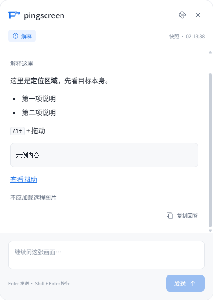
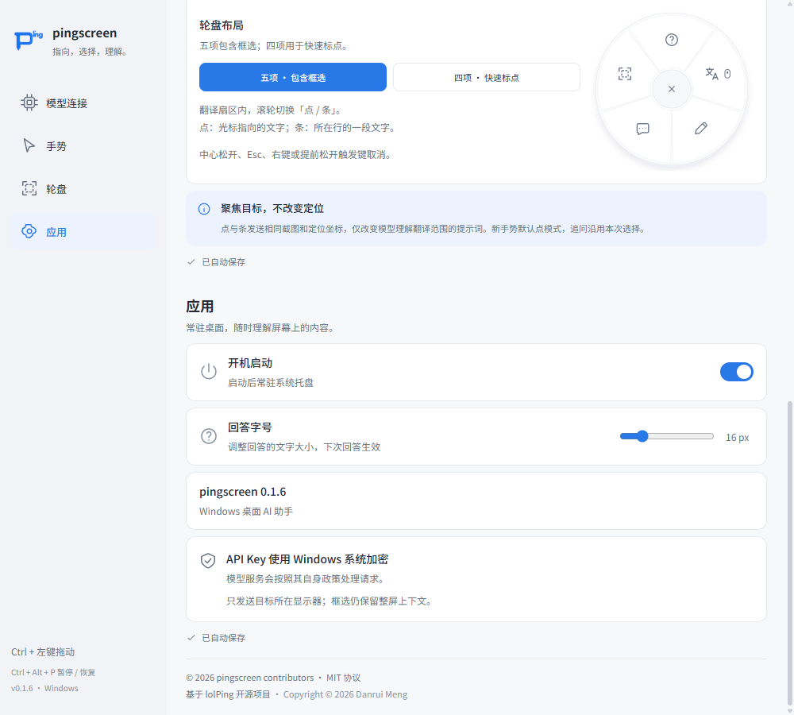

# 回答阅读体验验证

日期：2026-10-14。对应 OpenSpec 变更 `improve-answer-readability`。基于 0.1.6 的开发工作区实现，未发布新版本，也未生成新安装包；已有 0.1.6 安装版不自动包含本次修改。

此文件保留首轮字号与纵向卡片的验证记录。用户后续明确要求横向 16:10、仅品牌、隐藏截图与空白输入区，当前界面及验收请以 [简约回答卡片验证](2026-10-14-minimal-answer-card.md) 为准；下文的截图入口、纵向尺寸和顶部标签是历史方案，不代表最新界面。

## 实现效果

- “应用”设置中增加“回答字号”，默认 16px，支持 14–24px，每步 1px。修改自动保存，重启保留，从下一次回答生效；打开设置仍结束原会话。
- 正文、列表和链接使用所选字号；h1/h2 为 1.25 倍、h3/h4 为 1.125 倍、h5/h6 为 1 倍；代码和表格为 0.95 倍。输入区和按钮维持原有字号。
- 顶部品牌、意图和操作合并到约 52px 的区域，原先独立的意图/时间行移除，保留品牌和意图标签。
- 删除“快照 · 时间”和“整屏 + 定位”，截图入口改为“查看截图”。删除常驻快捷键说明，临时成功/失败反馈仍可见。
- 截图入口关闭时使用轻量透明背景；输入区以接近白色的底色和细边界与正文区区分；各轮回答没有新增重底色容器。

同一固定样例、440 × 620 窗口的对照（旧版正文 14px，新版默认正文 16px）：

| 调整前 | 调整后 |
| --- | --- |
|  |  |

## 已验证

### 设置与兼容

- 类型检查通过，50 项应用测试通过，其中字号设置相关测试覆盖缺失、空值、字符串、非有限值、上下界、整数步长、旧配置不主动重写和保存后重载。
- 旧配置缺少字号时使用 16px；无效值回退，有限越界值限制到 14–24px。修改字号不清空模型、密钥、手势和开机启动设置。
- 设置滑块具有正确的范围、步长和当前值，快速调整按队列保存最终值。
- 模拟自动保存失败时，显示错误并回退至已保存字号；未保存的模型草稿不会随字号修改被提交。
- 设置持久化通过保存后读取文件及重新创建 SettingsStore 验证；真实安装进程退出后重启另列为手动测试。

### 阅读与交互

- 本地 Electron 模拟流程通过；使用隔离配置、本地模型模拟服务和生成截图，不请求用户真实模型服务。
- 14px、16px、24px 分别在 440 × 620、320 × 480 中检查，共 6 组阅读样例：正文和标题/代码/表格尺寸正确，内容末尾可滚动到达，正文没有横向溢出，长代码可局部横向滚动，输入和发送按钮可操作。
- 待提问、生成中、已完成、已停止、请求失败、截图展开/收起、有/无截图状态的布局与必要反馈均通过检查。
- 保留截图目标标记和 capturedAt 数据；点击截图入口可以展开和收起。显示文字精简不会改变截图与追问语义。
- 实际键盘事件验证 Enter 发送、Shift + Enter 换行；组合输入事件验证中文输入法确认时不会误发问题。
- 复制成功时剪贴板内容正确并显示反馈；模拟复制失败时显示错误，不误报“已复制回答”。测试恢复了原先的文本剪贴板。
- 回答链接通过拦截外部打开调用验证目标地址，不实际打开外部页面。
- 同截图追问、停止、新会话取消旧请求以及真实失败后的重试通过；字号快照在流式更新、追问、重试和下一张卡片中保持正确。

### 环境与缩放边界

本机为 Windows，显示器物理分辨率 1920 × 1080，实际系统缩放 100%，工作区 1920 × 1032；使用 Electron 离屏窗口验证。

150% 和 200% 通过本地验证参数 `--smoke-reading-scale=1.5` / `=2` 和 Chromium 设备指标模拟检查，每种比例检查同样的 6 组字号/尺寸组合，要求 renderer.devicePixelRatio 分别为 1.5 和 2。它们是渲染模拟，不代表已把用户的 Windows 系统缩放改为相应比例，也不替代真实高 DPI 显示器测试。原生窗口在分数缩放下允许最多 1 个逻辑像素的几何舍入偏差，字体比例、正文溢出、内容可达性和操作区可见性仍严格检查。

本地详细结果位于 `.tools/smoke/results.json`、`reading-layout.json`，缩放模拟结果位于 `.tools/smoke/dpi-150/` 和 `dpi-200/`。真实 Windows 150%/200% 与多显示器体验尚待手动验收，OpenSpec 任务 5.2 保持未完成。

测试日志中的“模拟字号保存失败”“模拟保存失败”和“模拟复制失败”是用于验证错误回退的预期故障注入，不是实际运行中已知的保存或复制故障。

完整模拟流程的一次运行曾在首次生成等待时超过 8 秒，同一代码随后重跑通过。该瞬态超时尚未定位原因，保留为测试环境的稳定性观察；以上通过结果对应最后一次完整运行，不把重跑通过解释为已经修复该超时原因。

## 需要手动测试

请使用本次开发构建（运行 `npm run dev` 或 `npm start`），不要用原先已经发布的 0.1.6 安装程序判断新功能。若旧实例仍常驻托盘，先退出旧实例，再打开开发构建。

1. 在设置 → 应用将字号调到 18px 或 20px，确认显示“已自动保存”；重新发起一次提问，查看回答大小是否适合你的阅读距离。
2. 从托盘退出应用并重新启动，确认所选字号保留；再次修改到 14px/24px，确认只有新打开的回答采用新值。
3. 用真实模型获取含长段落、标题、列表、表格和代码的回答，检查大字号是否舒适、内容可滚动到底，以及宽表格/代码能否横向查看。
4. 实际使用中文输入法、Enter 发送、Shift + Enter 换行，检查没有误发送；尝试复制、停止、失败重试和截图查看。
5. 在你日常使用的 Windows 150%/200% 缩放或高 DPI 显示器上检查卡片清晰度、屏幕边缘位置、长回答与输入区。多显示器时在各显示器分别发起提问，并检查拖动后的卡片表现。
6. 主观确认顶部、截图入口和输入区是否足够简洁；当前删除范围仅为已确认清单，品牌、意图、问题、回答和必要反馈仍保留。

以上手动结果尚未获得，不将“字体更舒适”或真实多显示器正确性视为已经验收。
