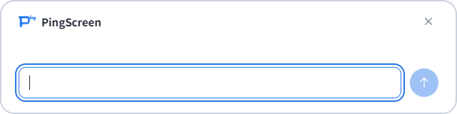
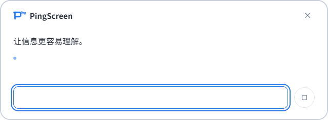
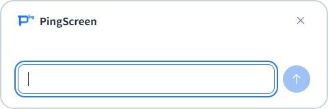
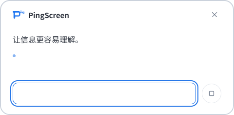
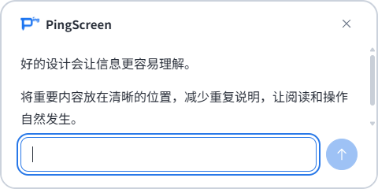

# 动态回答卡片验证 · 2026-10-14

## 归档验收确认

2026-10-14，用户在本会话明确确认“回答字号调整”已完成实际验收，并要求同步主规格及归档。以此作为剩余手动验收任务 5.2 的关闭依据，任务整体为 20/20 完成。最终验收方案为默认宽 640px、初始高 160px、最大高度等于实际宽度并受工作区限制。

此处记录用户验收结论；代理未在归档阶段另行执行真实设备测试，用户也未提供逐档 Windows 缩放及显示器配置明细。下文保留的“待手测”表述描述自动验证结束时的历史状态，不代表本次归档仍有待办。

## 后续尺寸调整（当前实现）

用户在本轮实现后要求宽度变为原来的 4/3，并将最大高度改为等于宽度。现已将默认宽度从 480px 改为 **640px**，初始高度仍为 **160px**，默认最高 **640px**。高度仍随内容增长，并受工作区限制；同一会话不因内容变短而收缩。

本次调整通过类型检查、56 项单元测试与完整 `npm run smoke`。最新 100% 渲染矩阵为 14/16/24px × 640×640、480×480、320×200，共 9 组；动态窗口检查确认初始 640×160、长回答达到 640×640、窄工作区受实际宽度限制、矮工作区受可用高度限制，关闭、滚动、追问和旧会话隔离继续通过。

本次 640px 方案没有重新运行 150%/200% 渲染模拟；下方三种密度的结果属于先前 480px 方案。真实 Windows 高 DPI、多显示器仍待手动验收。最新本地结果位于 `.tools/smoke/`，`dpi-150/` 和 `dpi-200/` 保留上轮结果。

手测重点：确认扩宽后的阅读体验、长回答增长到最多与宽度相等时是否合适，以及靠近屏幕底部时输入区仍可用。其余手动验收项目沿用文末清单。

## 上一版 480px 方案的范围与结果（历史记录）

开发工作区已实现最新确认方案：默认宽 480px，初始高 160px，随可见回答自然高度增高，默认最高 240px。上限按实际宽度的一半计算，并受显示器工作区约束；同一会话内容变短时不收缩，新会话恢复紧凑高度。超过上限后正文滚动，顶部及底部输入区保持可见。

右上角增加仅含 X 的关闭按钮，与 Esc 一样结束会话并中止生成。外边框为 2px、颜色 `#cbd2dc`，圆角 20px。字号设置、隐藏截图、用户问题、无提示输入框、圆形发送/停止、复制及失败重试继续可用。内容测量每 50ms 合并一次，整数去重，主进程负责工作区裁界及会话校验。

版本仍为 0.1.6，本次没有构建或发布新的安装包。上一版固定尺寸结果保留在 [简约横向卡片验证](2026-10-14-minimal-answer-card.md)，不能替代本轮验证。

## 已完成验证

- 类型检查通过；5 个测试文件、56 项单元测试通过。新增几何检查覆盖紧凑初始尺寸、内容增长、同会话保留高度、宽度一半上限、低工作区、负坐标及底部裁界。
- `npm run smoke` 通过。后续以 `--smoke-reading-scale=1.5` 与 `=2` 各运行完整流程，均通过。
- 静态阅读矩阵：14/16/24px × 480×240、400×200、320×160 × 100%/150%/200%，共 27 组。验证标题、代码和表格跟随字号，过宽代码可横向滚动，长回答可滚动到底，输入及按钮不溢出。
- 三套动态检查均读取实际 Electron 窗口边界：空白 480×160，逐段生成出现中间高度，长回答达到 480×240；停止、错误、重试及追问不使同会话收缩，静置不持续产生尺寸更新。
- 用户向上滚动时后续输出不夺走阅读位置；位于底部时继续跟随新内容。新会话恢复紧凑高度。
- 模拟受限工作区：400px 宽对应最高 200px、320px 宽对应最高 160px、900×200 工作区对应 480×200 卡片，均覆盖三个字号。底部增高会按需上移，已拖动的位置用于后续裁界；模拟移入更小工作区时窗口可达。
- 真实命令通路拒绝来自设置/选区窗口的高度请求、旧会话标识、非数值、非有限及负高度。关闭后的高度请求不重新显示窗口，也不改变新会话。
- X 的原生鼠标点击和键盘 Enter 激活通过；生成中关闭会中止请求并隐藏窗口，延迟响应不复活会话。Esc 行为同样通过。
- 原有回归流程通过：字号自动保存及失败回退、模型草稿隔离、截图上下文及追问、Markdown、复制成功/失败、链接、Enter/Shift+Enter、中文组合输入、停止和失败重试。

本轮初次新增测试遇到测试脚本顶层变量重复声明，以及模拟按钮 Enter 时缺少字符事件，均修正后通过。部分既有可选预览截图出现 `UnknownVizError`；它不影响行为检查，本轮下列三个动态卡片截图均成功保存。

## 视觉对照

同一段固定回答，上一版为 640×400，新版最高 480×240；尺寸不同是本次要求，正文超过可见区域时可以滚动。

上一版：

新版初始状态：

新版输出中：

新版完成状态：

## 环境与证据边界

本机显示器为 1920×1080，工作区 1920×1032，系统缩放为 100%。Electron 验证使用 offscreen 窗口；150%/200% 使用渲染设备密度模拟，不等同于更改真实 Windows 系统缩放。工作区和移入其他显示器使用合成数据及原生窗口移动事件，不等同于真实多显示器拖动。

模型请求由本地 HTTP 模拟服务提供，截图使用生成的本地画面；没有调用真实模型，也没有进行真实屏幕抓取。复制及链接测试使用隔离替身，不改用户剪贴板或打开外部网页。

本地详细结果（忽略入库）：`.tools/smoke/results.json`、`reading-layout.json`、`dynamic-layout.json`；150%/200% 对应 `.tools/smoke/dpi-150/` 与 `dpi-200/`。动态结果包含各检查点的真实窗口边界和控件位置。

## 需要手动验收

1. 用真实手势分别打开“提问”和“解释”：观察初始高度、真实流式回答增高、达到上限后的滚动，确认边框及圆角观感符合预期。
2. 设置字号为 16px、24px，阅读长回答、列表、代码和表格；确认内容可达，追问输入始终可用。向上滚动阅读时，不应被新输出拉回底部。
3. 分别在空白、完成和生成中点击 X；生成中关闭后等待片刻，应保持关闭。新开卡片应恢复紧凑高度；另检查 Esc、键盘聚焦 X 及顶部拖动。
4. 把卡片拖到屏幕底部再继续输出，检查窗口位置和输入区；在真实 Windows 100%/150%/200% 与多显示器之间重复，留意跨屏拖动、边界、文字清晰度和缩放后的实际大小。
5. 使用自己的模型确认截图理解及追问正常，检查停止、失败重试、复制和中文输入。不同模型的长段落、Markdown 输出节奏可能影响主观阅读体验。

真实高 DPI、多显示器及用户视觉验收尚未完成，任务 5.2 保持未勾选。
