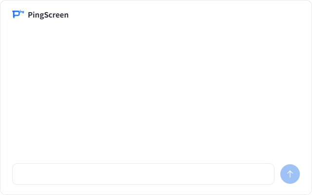
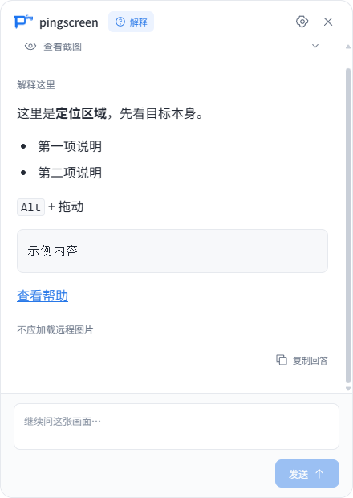
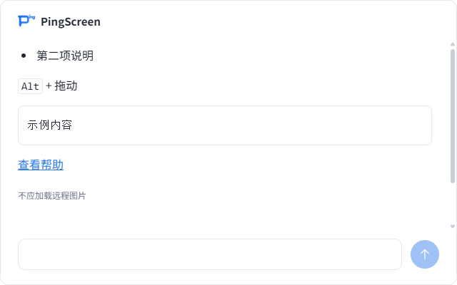

# 简约横向回答卡片验证

日期：2026-10-14。继续扩展 `improve-answer-readability`，替代首轮纵向卡片与截图入口。当前为未发布开发构建，版本号仍为 0.1.6，没有生成或发布新安装包。

## 当前效果

- 默认 640 × 400，宽高比 16:10。工作区较小时同比例缩小，位置沿用屏幕边缘裁界；用户不能手工拉伸窗口，仍能拖动卡片。
- 卡片纯白底，细边框及轻微圆角。左上角只显示 Logo 和 PingScreen，顶部没有“解释”等意图标签或设置/关闭按钮。
- 截图及定位预览不展示在卡片里，截图查看入口已移除。截图与定位数据继续用于模型理解和同画面追问。
- 首轮自动任务提示和初始空白说明不显示；用户真正输入的问题与回答保留。
- 下部为白色空输入框，无 placeholder，右侧同一行是圆形向上箭头发送按钮，无“发送”文字。
- 生成时同一圆形位置切换为停止图标；复制按钮在悬停或聚焦时显示，复制/失败反馈仅在需要时出现。
- 16px 默认字号、14–24px 调整范围及自动保存流程保留。输入框固定 14px，回答标题/代码/表格继续相对缩放。
- Esc 关闭卡片，设置从托盘打开；Enter 发送、Shift + Enter 换行保持可用。

模拟回答预览：

待提问状态：

同一固定回答样例的布局对照：更新前为 440 × 620，更新后为 640 × 400，图片保留各自真实比例。

| 更新前 | 更新后 |
| --- | --- |
|  |  |

## 验证结果

- 类型检查通过；54 项单元测试通过，包括默认尺寸、工作区宽度受限、高度受限、同时受限时的尺寸与比例验证。
- 完整 Electron 模拟流程通过，包含字号保存、失败回退、草稿隔离、Markdown、追问、停止、重试、新会话取消及 Esc 关闭。
- 所有界面样例均检查顶部仅 PingScreen、没有截图/定位 DOM、白色底、无输入提示、输入框与圆形按钮同一行、发送按钮无文字且具有可访问名称。
- 待提问、生成中、已完成、已停止、失败状态经过截图检查；必要错误与操作反馈按状态呈现。
- 阅读组合：14px、16px、24px × 640 × 400、480 × 300、320 × 200 × 100%、150%、200% 渲染比例，共 27 组。检查字号比例、正文无横向溢出、内容末尾可达、长代码局部滚动、输入与发送区可见。
- 工作区模拟额外验证实际固定窗口边界：480 × 600 → 480 × 300；900 × 300 → 480 × 300；320 × 200 → 320 × 200。检查窗口完整位于工作区内，尺寸缩小后仍不可手工拉伸，Esc 可关闭。
- Enter 与 Shift + Enter 使用键盘事件验证；中文组合输入确认不会误发送。实际中文输入法体验仍列为手测。
- 复制通过延迟成功/失败的剪贴板适配器验证，不访问或覆盖用户剪贴板。链接拦截外部打开调用验证地址，不实际打开外部页面。
- 从卡片状态转入设置仍结束原会话，保存字号后新卡片采用新值；API 的截图载荷及追问上下文保持，截图隐藏只影响显示。

## 环境与边界

Windows，本机实际显示器为 1920 × 1080、系统缩放 100%，工作区 1920 × 1032；测试使用离屏窗口、生成截图和本地模型模拟服务。

150%/200% 使用 `--smoke-reading-scale=1.5` / `=2` 及 Chromium 设备指标模拟，断言 renderer.devicePixelRatio 为 1.5/2，不修改 Windows 系统缩放。真实高 DPI 显示器、多显示器与真实模型仍待用户手测，OpenSpec 任务 5.2 保持未完成。

本地结果位于 `.tools/smoke/results.json`、`reading-layout.json` 及 `dpi-150/`、`dpi-200/` 对应目录。日志中的模拟保存/复制失败是测试所需的故障注入，最终结果以完整运行是否通过为准。

极小工作区配合 24px 时，可见回答行数明显减少，需要更多滚动；输入框与按钮仍保持可见。这是短而宽的比例与大字号组合的空间取舍。

## 手动验收

退出旧实例，在项目中运行 `npm start` 或 `npm run dev` 打开最新开发构建；原先安装版还没有此布局。

1. 查看 640 × 400 的默认比例、纯白底、品牌位置与留白是否符合预期。
2. 检查待提问时中部空白、输入框无提示，输入文字后圆形箭头能发送；生成时可停止。
3. 用真实中文输入法确认文字、Enter 发送和 Shift + Enter 换行；悬停回答检查复制图标，尝试复制及失败重试。
4. 在设置 → 应用调整字号并重新发起提问，检查长回答、列表、表格及代码的滚动和阅读舒适度。
5. 点击卡片使其聚焦后按 Esc 关闭，拖动顶部移动卡片，从托盘打开设置，确认移除顶部操作后仍顺手。
6. 在真实 Windows 150%/200% 和多显示器上，从屏幕边缘发起提问，检查比例、边缘裁界、清晰度和输入区可操作性。

上述真实桌面和主观观感尚未收到用户验收结果。
