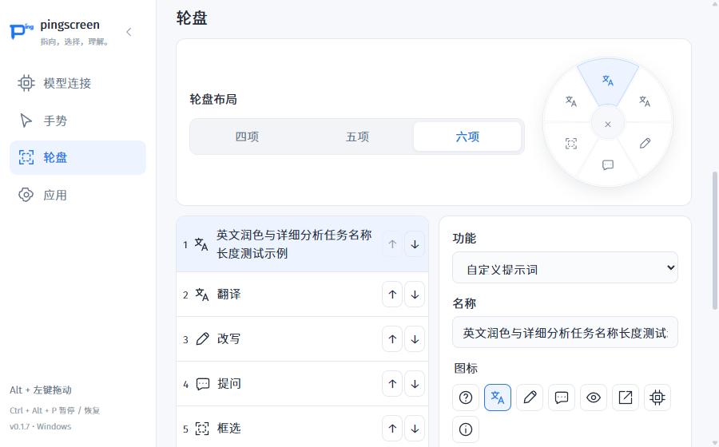
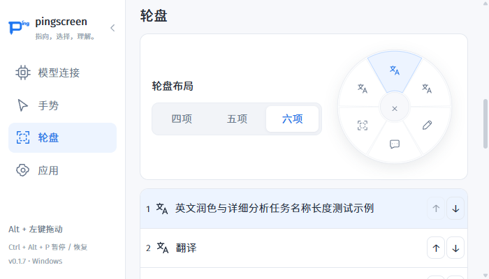
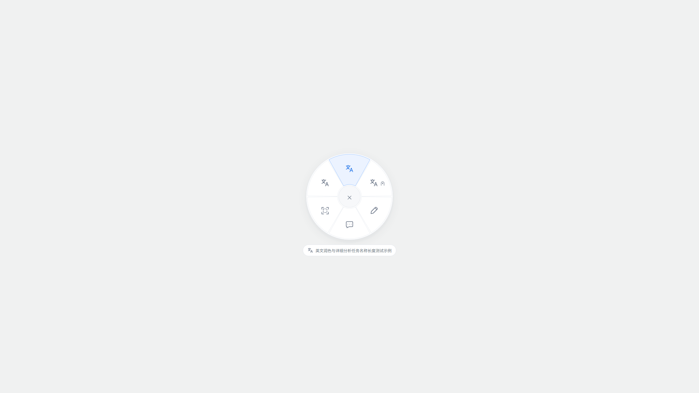
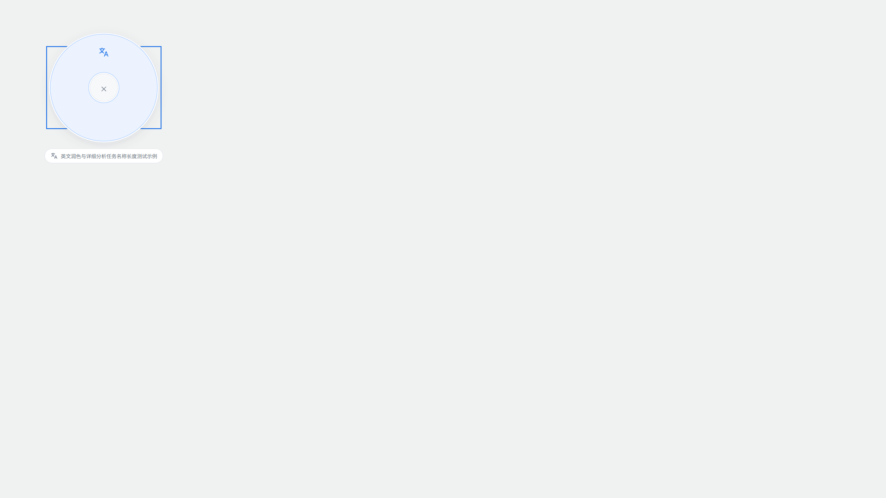

# 自定义轮盘验证

本记录对应第一版同页自动保存界面；后续三级页面与手动保存方案见 [轮盘编辑改版验证](2026-10-20-wheel-editor-redesign.md)。

日期：2026-10-20。对应 OpenSpec 变更：`customize-wheel-actions`。本次完成开发和本地验证，没有打包发布或归档变更。

## 结果

| 检查 | 结果 |
| --- | --- |
| `npm run typecheck` | 通过 |
| `npm test` | 7 个测试文件、70 项测试通过 |
| `npm run build` | 通过；完整 smoke 运行前重新构建 |
| `npm run smoke` | 通过，包含原有模型配置、输入、卡片、翻译及新增轮盘场景 |
| `openspec validate customize-wheel-actions --strict` | 通过 |
| `git diff --check` | 通过 |

单元测试使用临时配置目录。Electron smoke 使用独立的 `.tools/smoke/config` 与 userdata、本地 mock 模型及合成截图，不访问用户模型密钥或实际桌面截图。模拟 HTTP 503、设置写入失败、无效图标及复制失败产生的错误日志是预期测试输入。

首次完整运行在新增测试重新打开已隐藏设置窗口前发生导航超时；测试已改为先显示窗口并聚焦。修复后的完整运行通过，未跳过原有回归检查。

## 场景与证据

| 规格场景 | 验证 |
| --- | --- |
| 单一顺序在 6→4→5→6 中保留隐藏项 | `smokeWheel.ts` 通过实际设置按钮切换并比较完整配置；`settings.test.ts` 验证重建 SettingsStore 后保留 |
| 替换功能、调整顺序、隐藏槽位可编辑 | 设置首槽和隐藏第六槽为不同任务，真实按钮上移和键盘 Enter 下移；预览及运行时扇区数匹配 |
| 最小窗口与键盘操作 | `smokeSettingsInterface.ts` 验证 900×560、700×400 和两种侧栏状态的输入、提示词、排序、图标与导航可访问性；保存长名称和多行提示词后重复此矩阵 |
| 未完成及超限自定义草稿 | 实际输入空白名称、21 字符名称和 8001 字符提示词，不覆盖生效功能并显示字段错误；单测包含 20／8000 边界和 Unicode 码点 |
| 保存失败回退、草稿保留、连接隔离 | 模拟轮盘保存抛错，生效配置保持，文字草稿仍可编辑；后续保存恢复，无常驻成功提示；未保存模型名称仍在编辑器中且未写入连接 |
| 未知图标拒绝及损坏配置加载 | IPC 提交无效图标被拒绝且配置不变；单测验证加载未知图标、损坏功能和重复 ID 的可用回退 |
| 升级旧四／五项配置 | `settings.test.ts` 使用 version 1／2 旧配置验证读取不改写、原值保留、默认六槽位、首次保存备份原文、密钥与连接保留；默认第五项是框选、第六项是解释 |
| 框选过滤，不补入隐藏项 | 五项框选后只出现前四项，隐藏的第六自定义项未补入；隐藏、未知、框选自身 ID 均不能在区域功能阶段执行 |
| 没有框选入口、前四项全为框选 | 四项实际预览和运行时只含前四项；共享派生不额外插入功能；单测拒绝全为框选的前四项 |
| 单项区域轮盘 | 四项中三个框选，派生为一个自定义项，完整圆环路径、点击执行和取消均通过；截图人工核对 |
| 多个独立任务与相同图标 | 两项均使用翻译图标，各自发送英文润色／代码审查提示词；稳定 ID 区分，截图核对仅当前项高亮 |
| 点选立即执行、原始定位和早松开 | 在 PNG 返回前松开，随后直接修改持久化提示词，实际请求仍使用手势开始时的任务；请求定位为原始点而非松开位置，携带两张图片 |
| 自定义功能用于区域 | 框选后直接执行自定义任务，实际请求包含 region 定位、保存提示词及既有截图内容 |
| 输出偏好与通用规则 | 报文保留英文详细分析、JSON-only 指令；系统消息只含通用定位、历史快照、不确定性与截图为资料等规则，无默认中文、短回答、Markdown 和翻译点／条要求 |
| 首轮自动提示词隐藏、追问可见 | 实际卡片首轮无 question-label，用户追问显示；追问最后一条消息为用户问题，第一条图文上下文与首轮完全一致 |
| 重试、停止和关闭 | 首轮 503 后重试保留原提示词；已有内容停止后保持 stopped；生成中关闭后延迟返回不重开卡片；既有新会话隔离场景继续通过 |
| 流式与非流式 | mock 分别返回 SSE 和 JSON，提交报文 stream 与设置匹配，两条路径完成回答 |
| 预设提问与翻译 | 原有真实 Enter／Shift+Enter／IME 等待输入场景通过；四／五项翻译点／条及移动后的六项翻译预设通过，两个翻译槽位间切换重置范围；自定义翻译图标不附加翻译要求 |
| 无顶部说明及取消反馈 | 四／五／六项运行时与区域派生轮盘检查无 stage-hint；中心、Esc 和待截图取消回归通过，六项原始目标附近取消有几何单测 |

## 实际请求摘录

合成图像 1200×800，起始定位点为 (600,400)。请求的首段文字为：

```text
整屏截图尺寸：1200 × 800。用户定位：{"kind":"point","point":{"x":600,"y":400}}。
Analyze this target in English in detail. Output JSON only.
Keep the requested structure.
```

同一首轮消息还包含全屏截图和局部细节图。自定义系统消息不要求中文、短回答或 Markdown；另一个同图标槽位发送 `Review the code at this target. Output only actionable findings.`。模型格式服从率不属于确定性验证，本次验证的是发送内容及会话行为。

完整本地记录位于 `.tools/smoke/results.json`、`wheel-verification.json`、`settings-interface.json` 和 `dynamic-layout.json`，均为可重新生成的测试产物。

## 截图核对

配置编辑器：



700×400、侧栏展开，完整内容通过纵向滚动访问：



六项运行时轮盘：



仅剩一个可执行项的框选后轮盘：



## 验证范围限制

本次 Electron smoke 使用当前显示环境的真实窗口和渲染器，以及合成截图和本地模型。没有重新验证真实桌面的不同 DPI、多显示器、HDR 或受保护应用截图，也未请求云端模型；本变更不修改原生截图和输入协议。真实鼠标／触控板操作感受仍需用户体验确认。

升级首次保存前保留原设置备份，读取不主动写盘。降级操作遵循 README 的退出、备份当前文件、恢复升级前备份流程；没有启动旧版本执行真实降级。
