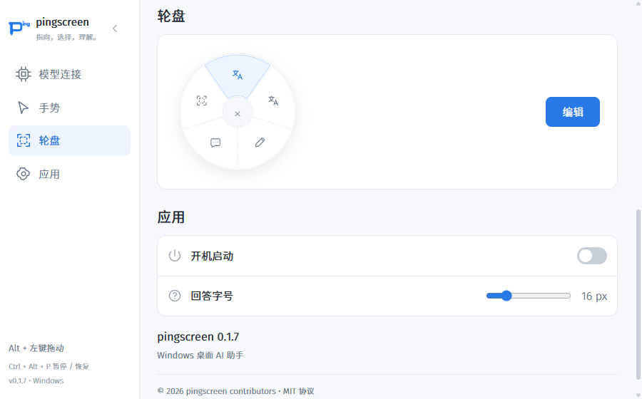
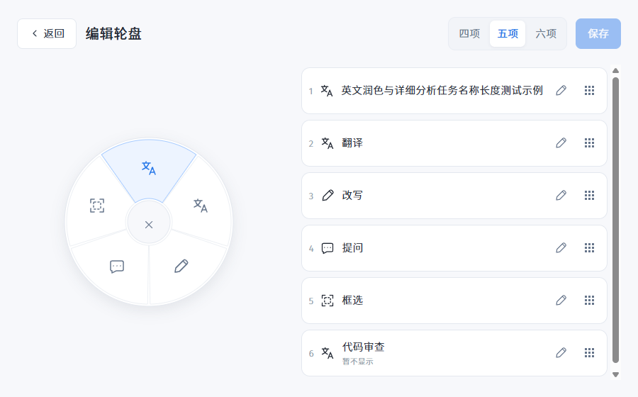
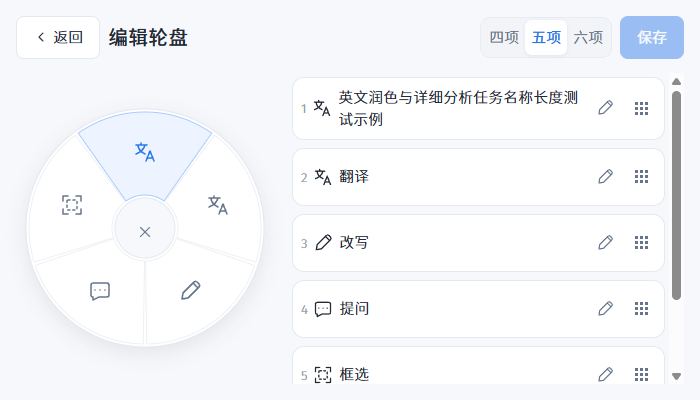
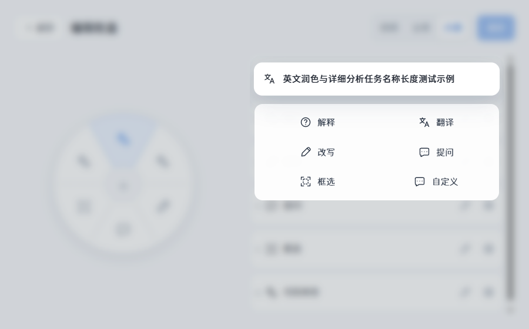
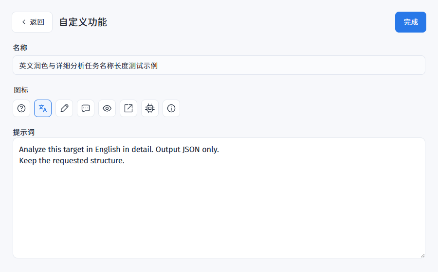
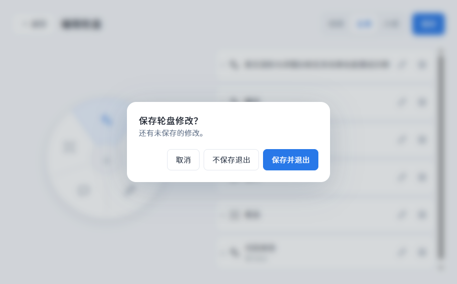

# 轮盘三级编辑流程验证

日期：2026-10-20。对应 `customize-wheel-actions` 第 6 节改版任务。第一版同页自动保存的验证保留在 [原记录](2026-10-20-custom-wheel.md)，本记录覆盖替代它的页面、排序和保存流程。

## 已实现的交互

- 主配置页轮盘分类仅有预览及右侧编辑按钮。
- 同一设置窗口进入占满窗口、隐藏主导航的二级页，顶部返回、项数选择、保存；左侧预览、右侧功能列表，隐藏项仍可编辑。
- 每行右侧仅有编辑和九宫格拖动手柄。按住左键排序，边缘自动滚动，Esc 取消并恢复；键盘聚焦手柄可用上下方向键排序。
- 只有编辑按钮触发选中项略微放大、其余背景虚化的功能菜单。菜单与当前项清晰可见，背景不可操作，Esc 或点击背景恢复列表及焦点。
- 选择自定义进入同样隐藏主导航的第三级页面，仅填写名称、图标、提示词，名称和提示词聚焦时不出现蓝色边线／外轮廓／光晕；完成只暂存并返回二级页，不能提前写盘。
- 所有修改在二级页统一保存。返回主配置页、切换分类和原生窗口关闭都接入保存／不保存／取消提示。校验或写入失败保留草稿并停留。
- 主预览与二级预览双向过渡位置和大小，减少动态效果模式直接切换；主页面滚动位置及模型连接草稿保留。

## 编辑页细节调整

后续小改动直接纳入同一变更第 7 节：二级／三级页隐藏主导航并占满窗口，返回后保留原导航状态；列表换位使用 220ms FLIP 位移动画，命中仍按未变形布局计算，避免动画引发来回换位；名称及提示词的聚焦边框保持中性。既有 smoke 增加窗口占满、侧栏不可见、排序动画存在和输入框聚焦样式断言，继续使用真实鼠标／键盘事件覆盖拖动、取消和自动滚动。

## 自动验证

| 检查 | 结果 |
| --- | --- |
| `npm run typecheck` | 通过 |
| `npm test` | 8 个文件、73 项测试通过 |
| `npm run build` | 通过，完整 smoke 前重新构建 |
| `npm run smoke` | 完整应用流程通过，包含服务商、截图会话、翻译、回答卡片及改版轮盘 |
| `openspec validate customize-wheel-actions --strict` | 通过 |
| `git diff --check` | 通过 |

新增 `tests/wheelDraft.test.ts` 验证草稿隔离、统一提交、无效字段阻止提交、保存失败保留内容及值比较不受对象属性顺序影响。已有持久化、几何和模型测试继续验证旧配置、独立槽位身份、区域派生、提示词及图片上下文。

`src/main/smokeWheel.ts` 使用实际 Electron 渲染器和原生输入事件验证：

| 场景 | 证据 |
| --- | --- |
| 分级导航及独立草稿 | 从主入口进入二级页，自定义进入三级页；修改两项、切换 6→4→5→6，配置文件仍不变，统一保存后两项一同生效 |
| 字段校验 | 空白、21 字符名称和 8001 字符提示词无法完成，合法的名称／图标／提示词能够暂存；未知图标 IPC 保存被拒绝 |
| 真正鼠标排序 | 使用 `sendInputEvent` 的 mouseDown／mouseMove／mouseUp 按住九宫格手柄拖动第六项至第五项；键盘向下恢复原位置 |
| 取消及边缘滚动 | 拖动中 Escape 恢复原顺序；700×400 窗口下指针停在列表下边缘引发自动滚动，取消仍恢复原顺序 |
| 聚焦与模态背景 | 普通行点击不打开菜单；编辑按钮打开；背景 blur 且 inert，Esc 恢复编辑按钮焦点，点击背景可关闭 |
| 手动保存及失败留页 | 失焦和三级完成不保存；保存时模拟失败，草稿保留；退出弹窗选择保存失败后不离开，返回三级页仍能编辑原文字 |
| 退出三个分支 | 返回、侧栏切换和原生 close 都受保护；取消保留页面，丢弃恢复生效值，保存成功后离开；无修改直接关闭和带修改丢弃后关闭均实际隐藏窗口 |
| 过渡及布局 | 检查进入和反向返回的预览动画、减少动态效果时无动画；900×560／700×400、展开／收起侧栏均保留左右两列且无横向溢出 |
| 模型和原有能力 | 模型连接草稿不随轮盘保存，原始点定位、同图追问、自定义首轮隐藏、框选、单项区域轮盘、重试、停止和关闭隔离继续通过 |

开发过程中，真实鼠标测试发现行重排会让随行手柄丢失指针捕获、导致顺序恢复。捕获已移至稳定列表容器；另外补全了聚焦菜单关闭时的明确焦点恢复。修复后原生拖动、取消和键盘流程通过。

测试启动也改为等待“设置”页面完成数据初始化，避免仅等待网页加载后误把短暂加载界面识别为失败。

保存失败、模型 503、复制失败和无效图标的错误日志属于注入的预期场景；测试使用独立设置目录、本地 mock 服务及合成截图，不访问用户桌面或云端模型。重跑可用 `npm run smoke`；开发调试可构建后运行 `npx electron . --smoke --smoke-wheel-only` 仅验证轮盘。

## 截图

主配置页：

二级编辑页：

最小窗口保持完整编辑页的左预览、右列表：

选中项和功能菜单保持清晰：

三级自定义配置：

未保存退出提示：

完整本地证据在 `.tools/smoke/wheel-verification.json`、`results.json`、`settings-interface.json`；截图在本文对应的 media 目录保留，可由 smoke 重新生成。

## 范围

本次验证包含实际窗口和渲染、原生鼠标与键盘事件、合成截图和本地模型报文；未重新验证真实多显示器、不同 DPI、HDR、受保护应用截图和云端模型输出。未打包发布或归档变更。模型、输入助手与原生截图协议沿用原实现。
